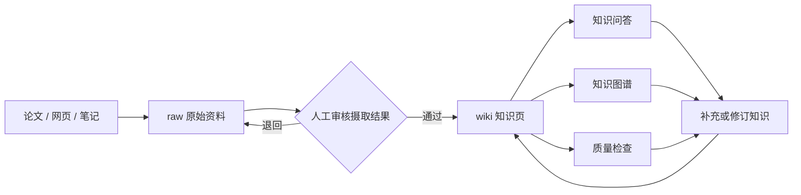

<div align="center">

# LLM Wiki 中文知识工作台模板

**本地优先 · 大模型驱动 · Markdown 可读 · 隐私默认关闭公开**

基于 [LLM Wiki](https://github.com/ddsyasas/llm-wiki) 构建的中文个人知识库实践，提供可复用的知识规范、演示资料、隐私边界和发布前检查流程。


</div>

## 界面预览


> 截图来自本机运行的真实 LLM Wiki v1.2.3 知识台。为保护隐私，截图没有展示本地路径、知识正文、聊天记录、API Key 或其他个人信息。公开仓库也不包含截图所连接的私人语料。

## 这是什么

LLM Wiki 是一个由大模型协助维护的本地知识工作台。原始资料和生成结果以 Markdown 保存在本机，大模型负责辅助整理、关联、检索和质量检查，人负责审核来源与决定哪些内容可以发布。

本仓库不是 LLM Wiki 上游应用的源码镜像，而是一套可以直接克隆使用的中文知识库模板，重点解决三个问题：

- 如何把论文、网页、笔记等资料整理成相互关联的知识页；
- 如何让知识问答、图谱和质量检查建立在可追溯资料之上；
- 如何在使用 GitHub 备份或分享模板时，不泄露 API Key、私人语料和操作轨迹。

## 主要能力

- **资料管理**：上传文档、粘贴笔记或导入网页，保留原始来源。
- **知识整理**：按统一规范生成概念、实体、来源、比较和综述页面。
- **知识关联**：通过 `[[slug]]` 链接和知识图谱发现跨页面关系。
- **知识问答**：围绕已有资料提问，并在回答中保留知识页引用。
- **AI 对话**：针对复杂问题进行多轮讨论，将有价值的结果沉淀为知识页。
- **质量检查**：发现内容矛盾、失效链接、缺少来源和知识缺口。
- **本地可控**：Markdown 可直接阅读和编辑，底层数据不依赖封闭云端格式。
- **发布隔离**：用 `.gitignore`、发布白名单和自动扫描控制公开范围。

## 知识如何流动



## 快速开始

### 1. 准备运行环境

- Node.js 20 或更高版本；
- LLM Wiki 命令行工具；
- 由你自行提供的模型服务配置（BYOK）。

安装官方工具：

```bash
npm install -g @syasas/llm-wiki
```

### 2. 克隆中文模板

```bash
git clone https://github.com/Jeremycarlos/llm-wiki.git
cd llm-wiki
```

如工具尚未自动创建本地索引和日志，可先复制空白模板。

Windows PowerShell：

```powershell
Copy-Item index.example.md index.md
Copy-Item log.example.md log.md
```

macOS / Linux：

```bash
cp index.example.md index.md
cp log.example.md log.md
```

### 3. 启动知识台

```bash
llm-wiki start .
```

默认端口是 `3737`。如需使用其他端口，例如 `3738`：

```bash
llm-wiki start . --port 3738
```

启动后，在浏览器中完成模型配置，再把自己的资料放入 `raw/` 并从“资料管理”开始摄取。

## 目录结构

```text
llm-wiki/
├─ CLAUDE.md                  # 中文知识规范与发布边界
├─ README.md                  # 项目介绍与使用说明
├─ index.example.md           # 本地索引空白模板
├─ log.example.md             # 本地操作日志空白模板
├─ publish-allowlist.txt      # 允许公开的文件白名单
├─ raw/
│  ├─ README.md               # 原始资料隐私说明
│  └─ demo-*.md               # 可公开的演示资料
├─ wiki/
│  └─ README.md               # 生成知识页隐私说明
├─ docs/images/               # 已脱敏的公开界面截图
└─ scripts/
   └─ check-sensitive.ps1     # 发布前敏感信息扫描
```

运行过程中还会产生以下本地内容，它们默认不会进入 Git：

- `.llm-wiki/`：设置、数据库、页面历史和回收站；
- `raw/` 中非演示文件：论文全文、网页正文和个人笔记；
- `wiki/` 中的知识页：由本地语料生成的知识内容；
- `chats/`：AI 对话记录；
- `index.md`、`log.md`：当前知识索引和操作轨迹；
- `.env`、密钥文件、凭证 JSON 和本地数据库。

## 隐私与发布模型

这个仓库采用“**本地完整知识台 + GitHub 脱敏模板**”的双层结构：

1. 本地工作区保留完整资料、知识页、索引、日志和运行状态；
2. GitHub 只接收 `publish-allowlist.txt` 明确列出的安全文件；
3. API Key、凭证、本地路径、聊天记录和未审核知识默认不公开；
4. 不要使用 `git add -f` 绕过忽略规则；
5. 即使内容来自公开论文，也要先确认许可证是否允许再分发全文。

界面功能不会因为脱敏而减少。公开仓库不携带私人内容，克隆者使用自己的资料后，仍可获得知识库、资料管理、知识图谱、知识问答、AI 对话和质量检查等完整能力。

## 发布前检查

在 Windows PowerShell 中运行：

```powershell
powershell -ExecutionPolicy Bypass -File scripts/check-sensitive.ps1
```

脚本会检查：

- 待发布文件是否全部位于白名单；
- 常见模型服务、GitHub、AWS、Slack 等凭证格式；
- 私钥、Bearer Token 和含账号密码的 URL；
- 邮箱、手机号、内网 IP 和 Windows 用户目录；
- Git 历史中的敏感内容和非 GitHub noreply 提交邮箱。

扫描通过后，再检查一次：

```bash
git status --short
```

确认没有私人文件进入提交列表后再推送。

## 常见问题

### 为什么克隆后没有我的 14 篇知识页？

因为它们属于本地知识数据，不是公开模板的一部分。脱敏的目标是保留完整产品能力，同时避免把私人语料和派生知识发布到 GitHub。

### GitHub noreply 邮箱会影响 PR 通知吗？

不会。noreply 只隐藏 Git 提交中的真实邮箱；PR、评论、@提醒和 Review 通知仍由 GitHub 的通知设置控制。

### 可以公开某一篇知识页吗？

可以，但应先完成隐私、版权、准确性、来源和链接审核，再把经过脱敏的副本加入专门的公开发布范围。不要直接强制添加整个 `wiki/` 或 `raw/` 目录。

## 上游项目与致谢

- [LLM Wiki](https://github.com/ddsyasas/llm-wiki)：本地优先、BYOK 的知识工作台；
- [Karpathy 的长期记忆与知识管理思路](https://gist.github.com/karpathy/442a6bf555914893e9891c11519de94f)：项目理念来源之一。

当前模板默认使用简体中文，并在 `CLAUDE.md` 中规定知识页语言、来源、事实边界和公开审核流程。
