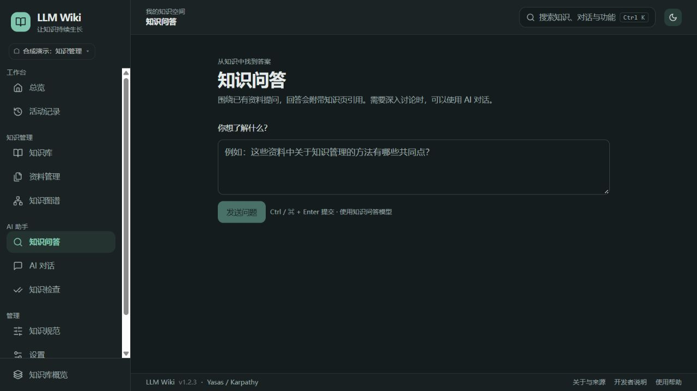

# LLM Wiki 中文知识工作台

把论文、网页和笔记整理成相互关联的知识页，用自己的阿里云百炼 API Key，在本机完成知识整理、检索问答和持续维护。

本仓库提供完整应用源码，包含中文界面、百炼模型接入和知识管理功能。安装后即可运行截图中的同款知识台，无需 OpenRouter 账号。每位使用者配置自己的密钥，导入自己的资料。



*中文知识问答页面。支持浅色、深色和跟随系统主题；知识内容与统计随各自导入的资料而变化。*

## 功能

- **资料管理**：粘贴笔记、导入网页或上传文档，保留原始资料和来源。
- **知识库**：AI 协助生成概念、实体、比较和主题综述，通过双向链接组织知识。
- **知识图谱**：查看知识页之间的关联，定位相关概念与主题。
- **知识问答**：围绕已有知识提问，查看引用，把有价值的回答保存为知识页。
- **AI 对话**：多轮讨论并整理对话，让临时思考沉淀为长期知识。
- **草稿审批**：先审核新增页、内容更新与矛盾，再确认应用。
- **知识检查**：检查断链、孤立页面、内容矛盾和知识缺口。
- **费用预估**：百炼人民币费用与 OpenRouter 美元费用分开显示；未知费率不按零费用处理。
- **本地存储**：知识页、原始资料和聊天以 Markdown 保存，可用其他编辑器打开。

## 安装与启动

### 1. 准备环境

安装 Node.js 20 或更高版本、Git，以及 `pnpm 10.12.1`。项目依赖安装在项目内。若使用 Node.js 20 的 Corepack，可通过 `corepack pnpm` 代替下列命令中的 `pnpm`；仓库已声明包管理器版本。

### 2. 下载并构建

```bash
git clone https://github.com/Jeremycarlos/llm-wiki.git
cd llm-wiki/app
pnpm install --frozen-lockfile
pnpm build:local
pnpm start
```

在浏览器打开 **http://127.0.0.1:3738**。运行期间保持终端开启，按 `Ctrl+C` 停止服务。若端口已占用，启动前设置 `LLM_WIKI_PORT` 为其他端口，例如 PowerShell 中执行 `$env:LLM_WIKI_PORT = '3740'`。

请从本仓库构建启动；全局安装的上游 `llm-wiki` npm 包不包含本分支的定制中文界面。

### 3. 填写自己的百炼 API Key

首次进入时，填写知识主题，在“阿里云百炼 API 密钥”中粘贴自己的 Key 并点击“保存密钥”，再点击“进入知识工作台”。无需修改源码或创建 `.env` 文件。

- 默认使用北京地域 API 地址；其他地域或业务空间的用户，在同一页面填写与密钥匹配的官方 API 地址。
- 资料整理、问答、对话与检查默认使用 `qwen-plus`；图片理解默认使用 `qwen3-vl-plus`。
- 模型须在对应地域有调用权限，可在“设置 → 模型设置”中更换。
- “测试连接”会发送一条简短合成提示，可能产生少量调用费用。

密钥优先保存在本机系统钥匙串；系统不支持时回退到用户目录的 `~/.llm-wiki-zh/config.json`。密钥不会随 GitHub 仓库提供，也不写入知识正文。本分支使用独立配置与钥匙串命名空间，可与上游安装并存。

## 第一次使用

1. 打开“资料管理”，粘贴一段笔记或导入一篇网页。
2. 等待 AI 生成草稿，阅读新增知识页、更新建议和矛盾提示。
3. 点击“确认应用”，在“知识库”中阅读结果。
4. 打开“知识图谱”查看关联，或在“知识问答”中围绕这些资料提问。
5. 继续添加资料，并定期运行“知识检查”完善内容。

仓库的 `raw/demo-*.md` 提供三份明确标注的演示材料，可用于体验首次摄取。

## 数据保存位置

默认知识库位于仓库根目录的 `.local/wiki/`。应用首次启动时自动创建所需目录，并放入中文知识规范。

```text
.local/wiki/
├─ CLAUDE.md       # 可在“知识规范”中编辑的写作规则
├─ raw/            # 原始资料
├─ wiki/           # 知识页
├─ chats/          # AI 对话
├─ index.md        # 自动维护的知识索引
├─ log.md          # 操作记录
└─ .llm-wiki/      # 数据库、设置和版本历史
```

如需使用其他数据目录，启动前设置 `LLM_WIKI_PATH`。例如 PowerShell：

```powershell
$env:LLM_WIKI_PATH = 'E:\MyKnowledge'
pnpm start
```

也可在“设置 → 知识库管理”创建和管理多个知识库。更改源码后，重新运行 `pnpm build:local` 并重启服务即可。

## 使用边界

- “本地存储”指资料和知识文件保存在本机；使用百炼时，相关提示和资料会发送给所选模型服务处理，并按服务商规则计费。
- 百炼视觉接口不支持此应用的原生 PDF 附件方式。PDF 请先转为 Markdown/文本，或将需要的页面转为图片；扫描 PDF 需要 OCR。
- 费用显示为估算，实际扣费以百炼账单为准。
- 知识库不包含预装的私人语料。首次使用的空内容状态采用同一套完整界面，导入资料后即可积累自己的知识页。
- 默认服务只监听本机地址。项目面向个人本地使用，没有面向公网部署的用户登录和权限管理。

## 源码与开发

```text
app/
├─ apps/web/          # 中文界面、API 和命令行入口
├─ packages/core/     # 知识库、摄取、问答和检查
├─ packages/llm/      # 百炼、OpenRouter 与 Ollama 模型调用
├─ packages/ingestion/# 资料格式检测与解析
├─ tests/             # 百炼路由、中文界面和发行版测试
├─ scripts/           # 本地构建与启动
└─ pnpm-lock.yaml     # 锁定依赖
```

测试与构建方法见 [开发说明](docs/development.md)。欢迎通过 Issue 提交问题，或通过 PR 改进功能；请提供复现步骤，并避免附带真实密钥或私人资料。

## 许可证与致谢

基于 [Yasas 的 LLM Wiki](https://github.com/ddsyasas/llm-wiki) v1.2.3 和 [Andrej Karpathy 的 LLM Wiki 思路](https://gist.github.com/karpathy/442a6bf555914893e9891c11519de94f)开发。软件遵循 [MIT 许可证](app/LICENSE)，上游版权声明保留在源码中。详见 [来源说明](THIRD_PARTY.md)。
